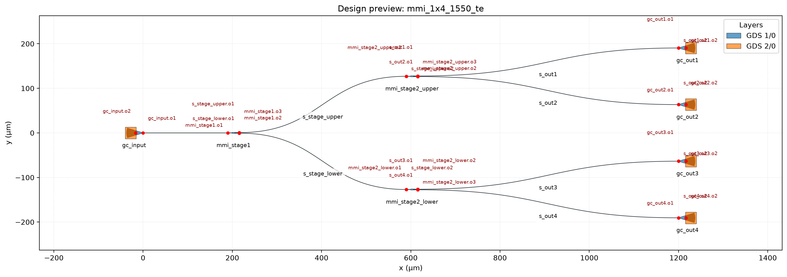

# gdsfactory MCP

一个基于 [gdsfactory](https://github.com/gdsfactory/gdsfactory) 的本地 MCP 服务，让 AI 可以创建、编辑、检查和导出光子芯片版图。

目前支持常用无源光子器件、器件摆放、端口连接、自动布线、设计检查，以及 GDS、JSON 和标注 PNG 导出。

> 本项目使用 generic PDK，适合学习、原型设计和 MCP 工具开发，不可替代晶圆厂 PDK、完整 DRC 或光学仿真。

## 安装

需要 Python 3.12 和 [uv](https://docs.astral.sh/uv/)。

```bash
git clone https://github.com/Poppy1517/gdsfactory-mcp.git
cd gdsfactory-mcp
uv sync
uv run python -m pytest
```

## MCP 配置

```json
{
  "mcpServers": {
    "gdsfactory": {
      "command": "uv",
      "args": ["--directory", "/absolute/path/to/gdsfactory-mcp", "run", "gdsfactory-mcp-server"]
    }
  }
}
```

将路径替换为仓库在本机的绝对路径即可。服务使用 stdio transport。

## Demo：1550 nm TE 1×4 分光网络

完整材料包（提示词、参数表、GDS、JSON、预览、KLayout 截图）：
[docs/demo/mmi-1x4-1550-te/](docs/demo/mmi-1x4-1550-te/)。

### 参数

| 参数 | 值 |
|---|---|
| 波长 / 偏振 | 1550 nm / TE |
| 拓扑 | 两级分光树：3× `mmi1x2`，1 入 + 4 出椭圆光栅耦合器 |
| strip 波导宽 | 500 nm |
| 欧拉弯曲半径 | 100 μm |
| 两级 MMI 横向间距 | 400 μm |
| 第二级上下间距 | 254 μm |
| 输出光栅纵向间距 | 127 μm |
| PDK | generic |

来源区分（提示词 vs 脚本默认）见 [PARAMETERS.md](docs/demo/mmi-1x4-1550-te/PARAMETERS.md)。

### 提示词

> 使用 gdsfactory MCP 设计一个 1550 nm、TE 模式的 1×4 分光网络：用三个 1×2 MMI 组成两级分光树，连接一个输入和四个输出椭圆光栅耦合器。采用 generic PDK 默认器件参数，strip 波导宽 500 nm，欧拉弯曲半径 100 μm。光路从左向右，两级 MMI 横向间距 400 μm，第二级上下间距 254 μm；四个输出光栅纵向间距 127 μm。



运行对应演示（写入 `build/mmi_1x4_1550_te/`；材料包内已有一份生成结果）：

```bash
uv run python scripts/build_1x4_mmi_network.py
```

## 更多信息

- [使用指南](docs/USER_GUIDE.md)：工具、参数、单位和错误排查
- [验收记录](docs/V0_1_ACCEPTANCE.md)：当前版本的验证范围
- [Demo 材料包](docs/demo/mmi-1x4-1550-te/)：1×4 MMI 可核对产物
